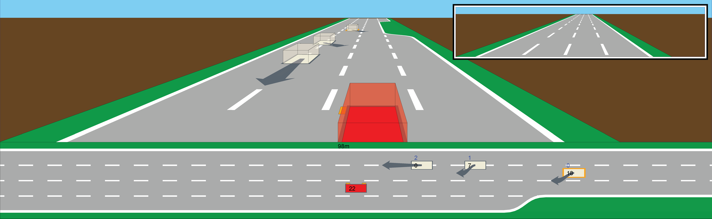

# vfm -- Model Checking for ADAS
Thank you for using
~~~
         ___           
.--.--..'  _|.--------.
|  |  ||   _||        |
 \___/ |__|  |__|__|__|
   very fast math
~~~

## The Library
`vfm` is a formal verification software for [ADAS](https://en.wikipedia.org/wiki/Advanced_driver-assistance_system) with the [nuXmv model checker](https://nuxmv.fbk.eu/) in its core. It can 
- parse C++ code of an automated driving function (or other) and translate it into a transition system for the nuXmv model checker;
- optionally integrate it with an environment model, providing a discrete traffic simulation for the driving function to be verified against; the results can be converted into scenarios using [OSM](https://wiki.openstreetmap.org/wiki/OSM_file_formats) / [OSC2](https://www.asam.net/static_downloads/public/asam-openscenario/2.0.0/welcome.html).

In **ultra-cooperative driving mode**, a fleet of cars can be steered live in traffic, by provably obeying a set of formal requirements (see below).

## Examples
### MC-generated traffic situation on highway


### MC-generated track and EGO behavior


## How to build
`vfm` is implemented in `C++` and can be built by simply running
```build.bash```
*(On Windows, you can alternatively open the top-level `CMakeLists.txt` with Visual Studio and build the `vfm` target.)*

Then, run `vfm(.exe)` from the `bin` folder.

### Build dependencies
| Dependency | Minimum version | Platform |
|---|---|---|
| CMake | 3.21+ | Both | 
| GCC/G++ | 7+ | Linux | 
| Visual Studio | 2019+ | Windows | 
| Git Bash / MSYS2 | — | Windows | 

### Troubleshoot
There are no additional dependencies, except `gtest` if you want to run the tests, and `opengl` if you want to compile fltk agains it. These dependencies are technically optional, but in the recent versions they are required for the build script to work. Should you receive errors, do:
```
sudo apt-get update
sudo apt-get install libgtest-dev
sudo apt-get install libglew-dev
```

## M²oRTy (Ultra-Cooperative Driving)
Safe trajectories by dis-proof of their non-existence.

https://github.com/user-attachments/assets/185897fe-c9f0-415a-b5c1-19f09b66bc73

https://github.com/user-attachments/assets/91c121bc-fe8a-4ee3-83e7-db243c79ec54

https://github.com/user-attachments/assets/0fe0c22f-3a62-4c92-a389-8c9bb43a658a

https://github.com/user-attachments/assets/672a190b-dda9-46ae-8ea5-2d1d5d000d5e

https://github.com/user-attachments/assets/7808511b-9011-4f86-9ca4-aa56a24c6255

https://github.com/user-attachments/assets/ad738fd3-6bef-4342-a084-2b2d9e7901ef

https://github.com/user-attachments/assets/c37c1992-e551-4de4-b90b-2dd72453c255

The nuXmv model checker steers several cars cooperatively to accomplish a given formal goal. In the example, two cars pass each other on a narrow road with parked cars ("Nudging") with safe, shortest possible collective trajectories. 

### More examples

https://github.com/user-attachments/assets/9a90fe6c-a15a-4501-ba12-ed2cd36e5cf2

https://github.com/user-attachments/assets/5bd3e109-6f2a-464b-b542-a6f33d6df1b5

(TL;DR: for details see [the paper](https://link.springer.com/chapter/10.1007/978-3-032-22752-2_31).)

### Running M²oRTy
For the UCD framework you need additionally `gymnasium` and `highway-env` (as well as python3 with pip which we assume is there):
```
pip install gymnasium
pip install "gymnasium[other]"
pip install highway-env
```

Run from the project root directory, for example:
```bash
python3 -m morty.morty --headless --record_video
```
The task to solve is defined in `morty/envmodel_config.tpl.json`. Use the `morty/master_templates` for a first trial.

### Driving-only mode
Rebuild the native library after updating, then run:

```bash
cmake --build build --target runTests --parallel
python3 -m morty.morty --live --num_runs 1
```

By default (`--mc_selection all`), `--live` keeps the configured model-checking algorithms, bounds, priorities, driving dynamics,
pure-pursuit formulas, and optional shortcut checks. It disables visualization, video, plots,
archives, experiment statistics, diagnostic logging, and the extra `FALSE`-specification debug
solve. Warnings and errors remain enabled. The ordinary experiment mode is unchanged.

To watch the simulation while retaining the live planning path, explicitly opt into the viewer:

```bash
python3 -m morty.morty --live --force_head --num_runs 1
```

`--force_head` requires `--live` and cannot be combined with `--headless`. Plain `--live`
remains fully headless. The viewer shows the road, vehicles, and vehicle IDs, updating once per
control cycle without a frame-rate delay. Physics stepping is unchanged. Trajectory overlays,
debug plots, statistics, video, archives, and the extra debug solve remain disabled. The window
has a status strip: yellow means `MC pipeline running` (full plan or numbered shortcut attempt),
while gray identifies input preparation, road rendering, result processing, and simulation steps.
The MC label includes the native input/solver/output pipeline, not just nuXmv CPU time. Status
changes are painted before blocking calls; the scene itself pauses while planning. Plain headless
`--live` does not paint or maintain these status updates. Rendering adds overhead, and generating the road
background once on the first cycle can take tens of seconds; use plain `--live` for timing
without visualization costs. A working graphical display is required (for example, X11
forwarding when running remotely).

Live runs retain the native library, launch configured models without artificial delays, reuse
prepared solver scripts and unchanged planner translations, and extract only the trajectory
prefix needed for control unless shortcut reuse requires the complete plan. The working
`debug_trace_array.txt` files are still needed to pass solver results to the controller; they
are overwritten, not archived. Future-point files are only produced when shortcuts are enabled.
Trace-variable lookups also avoid copying entire state dictionaries in both execution modes.
Parser dumps and GUI progress output are disabled, and cached debug files are not copied into
live working packages. Template metadata needed to validate the model cache is retained there.

Model generation and the initial planner translation are startup costs, not steady-state cycle
costs. Restart after changing the configuration or solver templates. Existing output-directory
checks still apply; choose `--press` or `--force` explicitly when reusing experiment paths.
`--live` rejects `--dryrun`, `--record_video`, and `--detailed_archive`.

On Linux, GNU `timeout` limits each solver process to the existing 300-second budget without a
global process-polling watchdog. This is an overhead-reduction mode, not a hard real-time
guarantee: solving the configured models can still exceed a few hundred milliseconds.

#### Task 7 Measurements (All Configurations)
Measured on Linux with nuXmv 2.2.0, using `morty/master_templates/task_7_tpl.json` unchanged
apart from isolated output/cache paths: ten vehicles, two lanes, sixteen prioritized models,
BMC bound 30, shortcuts enabled, seed 0. Model generation is excluded from cycle times.
The experiment baseline was headless, without video or detailed archives; both modes included
the shared trace-lookup optimization.

| Planning cycle | Experiment mode | Live mode |
|---|---:|---:|
| First full-plan cycle | 99.13 s | 51.32 s |
| Next shortcut cycle | 27.57 s | 4.73 s |
| Following shortcut cycle | 27.07 s | 4.81 s |

All three matched cycles produced identical selected priorities, shortcut decisions, actions,
and vehicle positions, with no crashes or blind steps. Shortcut cycles were about 5.7x faster.
Removing state-dictionary copies reduced coordinate extraction from 4.49 s to about 21 ms on
the first cycle, and from about 250 ms to 7-12 ms on shortcut cycles.

A separate three-repetition measurement of the same task's prepared shortcut query took
4.48-4.55 s for the sixteen-model solver batch, 96-105 ms for result processing, and about
6 ms for coordinate extraction. All prepared models remained byte-identical during that check.

An extended live run completed 22 cycles with no crashes or blind steps before the evaluation's
360-second wall-clock limit. Median completed-cycle time was 4.81 s. Cycles 17 and 18 took
57.59 s and 113.50 s because the existing shortcut policy issued seven and ten planning
attempts. The two moving vehicles passed each other, but had not cleared the full obstacle
corridor. This is not a completed-task or multi-seed safety validation, and **the 100 ms target
is not met**. Solver latency and repeated shortcut attempts remain the dominant limitations;
no model-checking heuristics were changed.

Focused regression checks:

```bash
python3 -m unittest morty.test_live_mode
./bin/runTests --gtest_filter='MortyLiveTests.*:MCTraceTests.*:GeometryScalingTests.*'
```

#### Adaptive MC Selection
To minimize sequential solver work, opt into one-configuration-at-a-time planning:

```bash
python3 -m morty.morty --live --mc_selection adaptive --num_runs 1
```

Add `--force_head` for the same optional viewer. Adaptive selection requires `--live`;
omitting it retains the original all-configuration policy. It changes which queries run and
their order, not individual solver algorithms, bounds, model parameters, or vehicle dynamics.
It can accept a lower-priority configuration without first trying every stricter one; preserving
trajectory shape or always selecting the highest feasible priority is not its objective.

The selector ranks configurations by observed query cost divided by estimated success
probability, separately for full goals and shortcuts. Estimates reset each run, with original
priority breaking ties. When shortcuts look cheaper, it first probes at most two configurations
against the nearest saved waypoint. It then tries full-goal configurations, returning on the
first usable result. If those all fail, it tries every remaining eligible configuration/waypoint
pair. Shortcut eligibility retains the previous full-plan winner's priority limit.

No generated package is removed or permanently blacklisted. Every configured full goal and
every eligible saved waypoint remains available before declaring an iteration blind; there is
no total query-count cutoff. Input geometry is prepared from the previous selected trace before
clearing working counterexamples. Skipped configurations cannot supply stale winners, and saved
future plans are retained for shortcut stitching. Exhaustive fallback preserves the candidate
set, but cannot guarantee a solution to an unsatisfiable or timed-out query or future states
reached along a different trajectory.

Separate Linux/nuXmv 2.2.0 measurements used a five-vehicle task-7 setup with two lanes, sixteen
size configurations and BMC bound 30. Both policies were run serially. With shortcuts disabled,
seed 0 completed in 19 planning cycles under both policies, with exactly identical actions and
vehicle positions and zero blind/crashed steps:

| Policy | Solver jobs | Summed solver time | Summed cycle time |
|---|---:|---:|---:|
| All configurations | 304 | 286.24 s | 293.40 s |
| Adaptive | 19 | 21.72 s | 24.87 s |

That is 92.4% less sequential solver time. Model generation and cached startup are excluded.
All sixteen EnvModels, solver commands, scaling files and planner sources were byte-identical
between these runs. The selected translated planner was also identical.

Adaptive completion checks across three seeds, each with shortcuts both enabled and disabled:

| Seed | Shortcuts | Planning cycles | Solver jobs | Summed solver time |
|---|---|---:|---:|---:|
| 0 | Off | 19 | 19 | 21.72 s |
| 0 | On | 19 | 20 | 24.11 s |
| 1 | Off | 18 | 18 | 28.18 s |
| 1 | On | 19 | 25 | 32.21 s |
| 2 | Off | 20 | 20 | 20.61 s |
| 2 | On | 20 | 21 | 22.49 s |

All six runs reached both model completion and the Python success condition with zero blind
steps and crashes. Seed 1 with shortcuts exercised a change from priority 0 to priority 1.
The shortcut-enabled all-config seed-0 baseline completed only two cycles within a 300-second
evaluation limit, using 128 jobs and 292.66 s of solver time. That is a partial baseline, not
an identical-trajectory or completed-run comparison.

The original ten-vehicle master, seed 0, reached the model's `FINISHED` state in 32 cycles,
using 51 jobs and 219.02 s of solver time, with zero blind steps and crashes. The driver ended
normally under its existing completion rule, but the Python success condition remained false:
the forward vehicle was about 9.6 cm short of its continuous-position threshold. This is not
an exact continuous-goal completion claim. Its first planning cycle still took 99.60 s, and
**the 100 ms target remains unmet**. These finite checks are not a universal safety guarantee.

#### Safety and Configuration-Pool Evaluation
The subsequent 40-trial study found blind initial states even with all 16 configurations,
blindness after removing a needed fallback, and crashes in reduced pools despite zero
blind iterations. These results do not justify removing the fallback range or treating
priority relaxation as safety-neutral. See
[morty/MC_SELECTION_EVALUATION.md](morty/MC_SELECTION_EVALUATION.md) for paired-policy results,
physical-clearance measurements, limitations, and the reproducible evaluator commands.

## Notes
The `very fast math -- Model Checking for ADAS` project is [open-source](https://github.com/coenig/very-fast-math). Academic publications:
- TACAS 2024: [Towards Safe Autonomous Driving: Model Checking a Behavior Planner during Development](https://link.springer.com/chapter/10.1007/978-3-031-57249-4_3)
- IEEE Transactions on Intelligent Transportation Systems: [Exploiting Formal Verification for the Systematic Discovery of Corner Cases in a Behavior Planner for Automated Driving](https://ieeexplore.ieee.org/document/11523162)
- TACAS 2026: [Driving by Disproof: A Practical Model Checking Approach to Fleet Coordination](https://link.springer.com/chapter/10.1007/978-3-032-22752-2_31)
- Work in progress: Ultra-Cooperative Driving -- Safe Trajectories from Dis-Proof of their Non-Existence (to be submitted to: IEEE Transactions on Intelligent Transportation Systems)

## Authors
Lukas Koenig,
Alexander Georgescu,
Christian Heinzemann,
Christian Schildwaechter,
Michaela Klauck,
Alberto Griggio,
Alberto Bombardelli,
Henning Koch et al.
